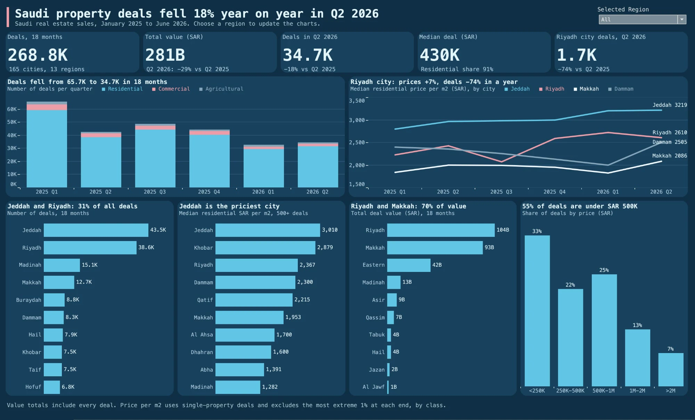

# Saudi Real Estate Deals

Saudi property deals fell 18% year on year in Q2 2026. This project tracks how property sales moved over 18 months, where value is concentrated, and whether falling deal numbers came with falling prices.

## Key results

- **-18%** fewer deals in Q2 2026 than in Q2 2025, and 29% less total value.
- **-74%** deals in Riyadh city in one year, while its residential price per m2 rose 7%.
- **70%** of total deal value over the 18 months came from the Riyadh and Makkah regions.

**Recommendation:** track prices by city rather than by region. The median for the Riyadh region halved because deals moved away from the city, which fell from 66% to 39% of the region's valid residential deals, while the city's own price rose.

## Data

Source: real estate transactions published quarterly by the Ministry of Justice on the [Saudi Open Data Platform](https://open.data.gov.sa), Q1 2025 to Q2 2026. The original quarterly files are not stored here because of their size. `python/fetch_realestate.py` downloads them from the platform. The source describes these as the main approved sale deals, so totals may not cover every sale in the Kingdom. The data shows what changed, not why.

## Steps

1. `python3 python/fetch_realestate.py raw` downloads the six quarters.
2. `python3 python/re_clean.py raw <output_dir>` combines them, removes rows without a deal reference, standardises the fields, flags valid price per m2 values, and writes the cleaning log.
3. `excel/real_estate_cleaning.xlsx` holds the documented cleaning output.
4. `dashboard/real_estate_dashboard.twbx` is the Tableau dashboard.

## Tools

Python, Excel, Tableau
